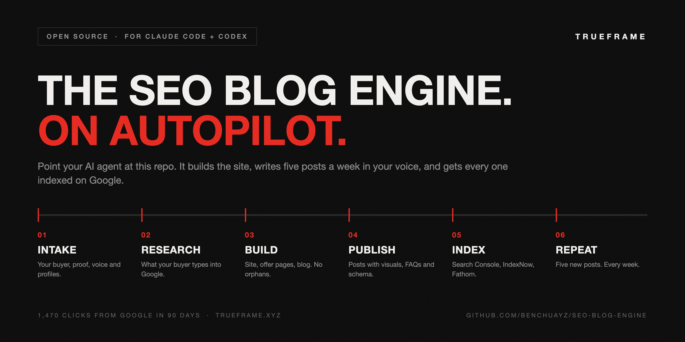

<p align="center">
  
</p>

# SEO Blog Engine

**Point Claude Code or Codex at this repo and it builds you a site that brings in leads from
Google. Then it writes five new posts a week, publishes them and gets them indexed.**

---

## Why we built this

i run [Trueframe](https://www.trueframe.xyz), a content agency for founders.

Marketing is about the most crowded space there is to sell in. Every agency is posting,
running ads and cold emailing the same founders. Ranking on Google there feels impossible
until you see how most of the competition actually blogs: generic posts written for
"everyone", answers buried, no structure Google can read, and nothing anyone could only
get from them.

So we did the opposite. One post per real question our buyers type into Google. The answer
up top. Real numbers from our own work. Visuals that explain it. Every post linked into the
site so Google actually finds it.

In the last three months (Aug to Oct 2026), trueframe.xyz pulled **1,470 clicks and 56,000+
impressions from Google search**, without paying for any of them. Some of those readers
book calls. The posts keep doing that whether we touch them or not.

That's the whole idea. Every post is another door into your business that stays open
forever. Five new doors a week compounds FAST.

This repo is that system, packaged so your AI agent can run it for you.

## How it gets you leads on autopilot

```
buyer types a question into Google or ChatGPT
        ↓
your post is the best answer (first paragraph, real proof, visuals, FAQs)
        ↓
one CTA to your offer page, tagged with the post it came from
        ↓
they book. you can see exactly which post earned it
        ↓
every week: 5 more posts, each one linked in, pinged to Google and Bing, checked until indexed
```

## Start here (5 minutes)

**Option 1: point your agent at it.** Clone the repo and open it in Claude Code or Codex:

```bash
git clone https://github.com/benchuayz/seo-blog-engine.git
cd seo-blog-engine
claude        # or: codex
```

Then say: **"build my SEO site with this repo."**

The agent reads [`AGENTS.md`](AGENTS.md) and runs the whole thing: it asks about your
business, researches what your buyers search, builds the site, writes the first posts,
installs analytics, sets up Google Search Console, gets you indexed and (if you want)
schedules five new posts a week. It stops and checks with you at each big decision.

**Option 2: you already have a site.** Open your site's repo in your agent and say:
*"Install and run the SEO blog engine from github.com/benchuayz/seo-blog-engine on this
site."* It copies the skill in and works with your stack (Next.js, Astro, WordPress, anything).

**Option 3: just the skill.** `cp -r skill/seo-blog-engine ~/.claude/skills/` (Codex:
`~/.agents/skills/`), then `/seo-blog-engine build` in any project.

What you'll need to have handy: what you sell and who to, a few results with real numbers,
3 to 5 things you've written, your social profile links, and logins for your domain and
hosting. That's it.

## What it does, end to end

| Step | What happens | Doc |
|---|---|---|
| 1. Intake | Your buyer, offer, proof, voice, and your YouTube/Instagram/LinkedIn profiles | [SKILL.md](skill/seo-blog-engine/SKILL.md) |
| 2. Research | 30 to 50 questions your buyers search, scored and grouped into topic clusters | [RESEARCH.md](docs/RESEARCH.md) |
| 3. Build | Homepage, offer page, one page per buyer type, about page, blog. Everything linked. | [SITE-STRUCTURE.md](docs/SITE-STRUCTURE.md) |
| 4. Write | Posts in your voice, with infographics and your own videos embedded | [BLOG-FORMULA.md](docs/BLOG-FORMULA.md) |
| 5. Analytics | Fathom installed and verified | [FATHOM.md](docs/FATHOM.md) |
| 6. Index | Search Console, sitemap, IndexNow, Bing, request indexing, diagnosis | [INDEXING.md](docs/INDEXING.md) |
| 7. Autopilot | 5 posts a week, published, pinged, checked, reported | [WEEKLY-AUTOPILOT.md](docs/WEEKLY-AUTOPILOT.md) |

## How we structure a post (and why it ranks)

Every post follows the same shape: the answer in the first paragraph, one point per
section, each section handling one "yeah, but...", a "short version" recap, 4 to 6 FAQs
in the buyer's own words, and one call to action.

What makes it worth ranking is what generic AI posts can't fake: a real example from your
work, a number from your results, a how-to the reader can use today. That's why the engine
builds from your own calls, videos and proof, and never invents a stat.

Under the hood every post ships with full structured data (article, FAQ, breadcrumbs,
video) so Google shows rich results and ChatGPT, Perplexity and Claude can quote it.
Details: [BLOG-FORMULA.md](docs/BLOG-FORMULA.md) and [SEO-GEO-PLAYBOOK.md](docs/SEO-GEO-PLAYBOOK.md).

## Visuals made from the text

Walls of text lose people. After writing a post, the agent reads it back, picks the 1 to 3
sections that would land faster as a picture, and renders an infographic for each from
the post's own words and numbers (frameworks, timelines, stats, comparisons). It checks
every render before it goes in.

It also asks for your profiles (YouTube, Instagram, TikTok, LinkedIn, podcast) so it can
embed your own videos and posts wherever they fit. Your blog sends viewers to your
channels, and your content proves the post. Same profiles go into the author schema, so
Google connects the person on the blog with the person on YouTube.
[VISUALS-AND-EMBEDS.md](docs/VISUALS-AND-EMBEDS.md)

## Getting indexed (the step everyone skips)

A page Google hasn't indexed can't rank. The engine sets up Search Console, submits your
sitemap, pings Bing through IndexNow, requests indexing for your key pages, and checks every
new post until it's in, reading Google's own reason when it isn't. We learned the hard way
that the #1 cause is pages nothing links to, so the site structure is built to prevent it.
[INDEXING.md](docs/INDEXING.md)

## Five new posts a week, on autopilot

Once you're live, schedule `/seo-blog-engine weekly` (Claude desktop app, Claude Code
`/schedule`, GitHub Actions or cron). Every week it picks 5 topics from your backlog and
your Search Console data, writes them, adds visuals, links them in, publishes, pings the
search engines, checks last week's posts got indexed, and sends you a report. It opens a
pull request for you to approve until you tell it to publish directly.
[WEEKLY-AUTOPILOT.md](docs/WEEKLY-AUTOPILOT.md)

## Analytics

We use [Fathom](https://usefathom.com/ref/WQFIKH) on our site and every client's. No
cookie banner, no slowdown, one clear dashboard. Sign up through our link and you get
**$10 off your first invoice** (it's our referral link, so we get a small commission too).
It's already wired into the blog module: paste your site ID and redeploy.
[FATHOM.md](docs/FATHOM.md)

## What's in the box

```
seo-blog-engine/
├── AGENTS.md                  the agent runbook (Codex reads it; CLAUDE.md points Claude at it)
├── skill/seo-blog-engine/     the skill: build, setup, research, cook, batch, weekly, index
├── blog-module/               working Next.js site + blog (schema, sitemap, llms.txt, Fathom)
├── scripts/seo.mjs            Search Console + IndexNow helper, zero dependencies
├── docs/                      the playbook, one file per step
├── templates/                 config, backlog, publishing log, infographic, GitHub Action
├── assets/                    this cover
└── examples/                  a worked intake-to-post walkthrough
```

## Requirements

- [Claude Code](https://claude.com/claude-code) or [Codex](https://openai.com/codex) (or any agent that can read files and run commands)
- Node 20.9+ for the blog module and `scripts/seo.mjs`
- A domain, and somewhere to host (Vercel's free tier works)

## Secrets

Nothing in this repo contains real keys. Your keys live in `.env.local` and your host's
settings, both kept out of git. See [`.env.example`](.env.example).

## License

MIT. Use it, fork it, build a business on it. See [`LICENSE`](LICENSE).

---

## Built by Trueframe

Built by [**Trueframe**](https://www.trueframe.xyz)
([Benjamin Chua](https://www.linkedin.com/in/benchuchu/)). We run done-for-you content
engines for founders and high-revenue brands: video, blogs, the lot.

**Want the whole thing run for you instead?** Book a call at
[**www.trueframe.xyz**](https://www.trueframe.xyz).

If this helped, a star on the repo is appreciated.
